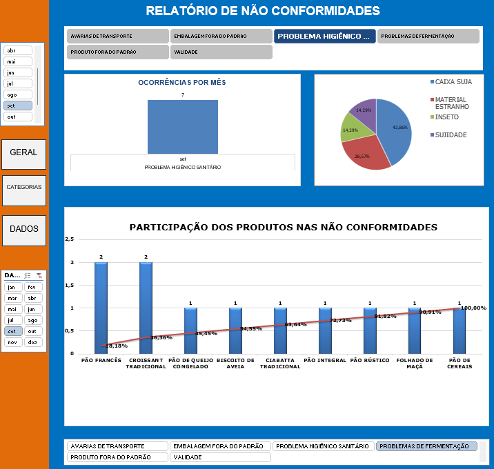
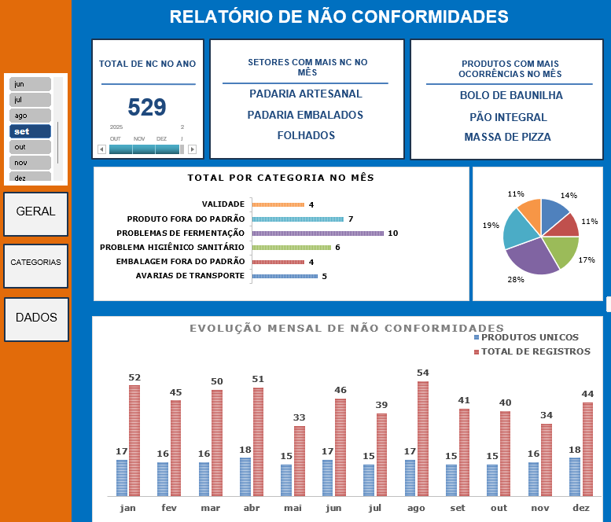
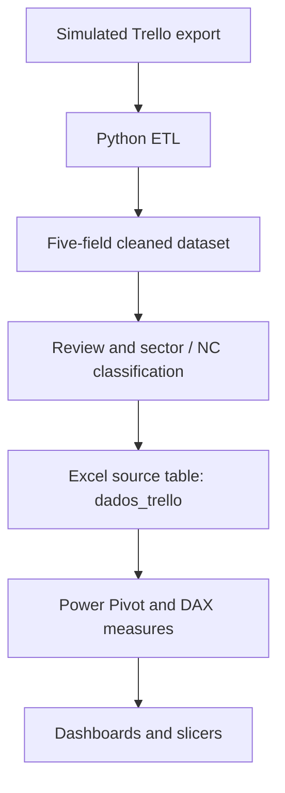

# Quality Analytics — Non-Conformity Management

[Versão em português](README.md)

     

## Overview

My first major data analytics project grew out of a real business need. While working as a Quality Analyst in the food industry, I developed a solution from scratch to turn non-conformity records into structured data, operational KPIs and management insights.

The project combines Trello data extraction, cleaning and validation, Python automation, Power Pivot data modeling, DAX measures and interactive Excel dashboards to support the investigation of recurring issues and continuous improvement.

This portfolio edition preserves the original dashboard architecture and design while replacing tabular records with fully synthetic data. All displayed results are illustrative and do not represent actual company performance.

## Dashboard

### Executive overview



The overview displays annual occurrence counts, the most recurrent sectors and products for the selected month, category distribution and monthly trends in records and unique products.

### Category analysis



This page supports investigation of specific categories, breakdowns by non-conformity type and product prioritization through a Pareto chart with cumulative percentages.

The screenshots show independent filters: the upper charts and Pareto chart can represent different subsets. In the overview screenshot, the category breakdown does not sum to the monthly count in the historical chart. Check the slicer connections before combining those totals.

## Business challenge and my contribution

Operational quality records were stored in cards containing text that required preparation before analysis. The goal was to streamline repetitive manual tasks, standardize classification and provide management with a clearer view of recurring issues.

My contribution included:

- Structuring the dataset and defining operational KPIs.
- Extracting, cleaning, standardizing and validating records.
- Developing dashboards, pivot tables, slicers and DAX measures.
- Automating data preparation with Python, using AI assistance and reviewing the results.
- Investigating deviations and presenting analytical information to management.
- Documenting the extraction, transformation and dashboard refresh process.

## Data architecture



Sector and non-conformity type classification is a separate step supported by Excel validation lists. The script does not automate this classification or the Power Pivot refresh.

## Demonstration dataset

| Attribute | Value |
|---|---:|
| Synthetic records | 529 |
| Period | 2025 |
| Fictional stores | 6 (L01–L06) |
| NC categories | 6 |
| Sectors | 14 |
| NC types | 23 |

The final table contains ID, date, store, product, description, category, sector and NC type, with Portuguese field names retained for compatibility with the original workbook. See the [data dictionary (Portuguese)](docs/data_dictionary.md).

## ETL and data quality

The `processar_nc.py` script uses Pandas, regular expressions, Unicode normalization and OpenPyXL to:

1. Read CSV or XLSX exports and validate required columns.
2. Filter cards in the `MÊS ATUAL` list, used as a selection marker in this demonstration.
3. Parse dates, stores and products from card titles, including fields in different orders.
4. Standardize store codes, convert dates and extract categories from labels.
5. Flag incomplete or ambiguous records for manual review.
6. Export a formatted five-field Excel dataset.

Dates without a year default to 2025. The simulated raw file was generated from the synthetic dataset; it is not an original corporate export.

## KPIs and analytical logic

| KPI | Purpose |
|---|---|
| Annual NC count | Track occurrence volume |
| Monthly trends | Identify changes over time |
| Unique products | Measure the variety of affected products |
| Sectors with the most NCs | Prioritize investigations |
| Recurring products | Identify concentrations of issues |
| Category and type breakdown | Understand the composition of occurrences |
| Product Pareto | Show frequency and cumulative contribution |

The original `Qtd Distinta` measure uses `COUNT(dados_trello[ID])`, not `DISTINCTCOUNT`. These counts coincide because synthetic IDs are unique. Occurrence counts are not defect rates because production-volume denominators are unavailable.

## Run locally

**Requirements:** Python 3.10+ and desktop Microsoft Excel for Windows with Power Pivot to explore and refresh the dashboard.

From the repository root:

```bash
python -m pip install -r requirements.txt
python scripts/processar_nc.py data/raw/trello_export_synthetic.csv data/processed/non_conformities_clean.xlsx
python -m unittest discover -s tests -v
```

Open [quality_dashboard.xlsx](dashboard/quality_dashboard.xlsx) in Excel. The fully classified demonstration dataset is available at `data/processed/dashboard_input.xlsx`. Follow the [technical guide (Portuguese)](docs/user_guide.md) to refresh the workbook while preserving the `dados_trello` table and Data Model. Do not resave the dashboard using libraries that cannot preserve Power Pivot.

## Repository structure

```text
├── README.md
├── README.en.md
├── requirements.txt
├── .gitignore
├── assets/
│   ├── dashboard_overview.png
│   └── dashboard_categories.png
├── dashboard/
│   └── quality_dashboard.xlsx
├── data/
│   ├── raw/trello_export_synthetic.csv
│   └── processed/
│       ├── non_conformities_clean.xlsx
│       └── dashboard_input.xlsx
├── scripts/processar_nc.py
├── tests/test_processar_nc.py
└── docs/
    ├── user_guide.md
    ├── data_dictionary.md
    └── privacy_and_data.md
```

## Technologies and skills

**Advanced Excel · Power Pivot · DAX · Python · Pandas · OpenPyXL · ETL · Data Quality · KPIs · Pareto Analysis · Technical Documentation**

## Privacy and limitations

T### 🔒 Privacy and Confidentiality

The disclosure of this project for professional portfolio purposes was authorized by the management of the company where the solution was originally developed.

To preserve corporate confidentiality, the original tabular records were replaced with a synthetic dataset containing 529 records, maintaining the dashboard's analytical structure and functionalities.

This project is intended for demonstration and educational purposes.


## Author

**Rafael Gaygher** — Data Analytics & Business Intelligence

[LinkedIn](https://www.linkedin.com/in/rafael-gaygher/) · [GitHub](https://github.com/devGaygher)
