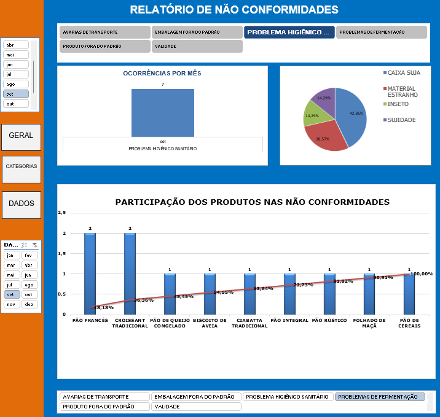
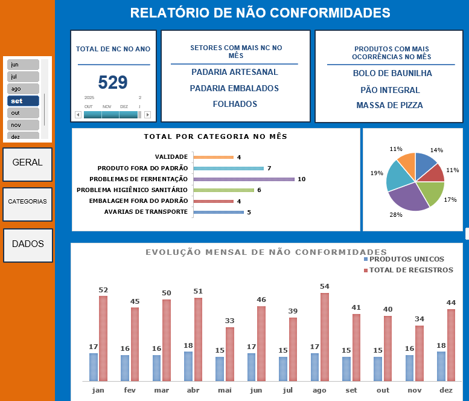
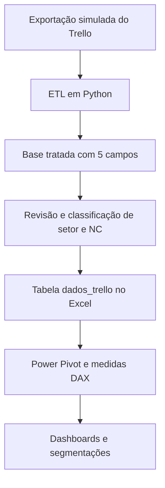

# Quality Analytics — Gestão de Não Conformidades

[English version](README.en.md)

     

## Visão geral

Meu primeiro grande projeto de análise de dados nasceu de uma necessidade real do ambiente profissional. Durante minha atuação como Analista de Qualidade no setor alimentício, desenvolvi do zero uma solução para transformar registros de não conformidades em informações estruturadas, indicadores operacionais e análises gerenciais.

O projeto reúne extração de dados do Trello, tratamento e validação de registros, automação em Python, modelagem no Power Pivot, medidas DAX e dashboards interativos no Excel. A proposta é facilitar a identificação de recorrências, desvios e oportunidades de melhoria contínua.

Esta versão de portfólio mantém a arquitetura e o design do dashboard original, mas utiliza registros tabulares inteiramente sintéticos. Os resultados são demonstrativos e não representam o desempenho de uma empresa real.

## Dashboard

### Visão geral



O painel apresenta o volume anual de ocorrências, os setores e produtos com maior recorrência no mês selecionado, a distribuição por categoria e a evolução mensal de registros e produtos únicos.

### Análise por categorias



A segunda página permite investigar categorias específicas, visualizar a distribuição dos tipos de não conformidade e priorizar produtos por meio de um gráfico de Pareto com percentual acumulado.

As capturas mostram filtros independentes: na página de categorias, os gráficos superiores e o Pareto podem representar recortes distintos. Os valores da visão geral também devem ser interpretados considerando os filtros de cada visual; a soma por categoria na captura não coincide com o total mensal da série histórica. Não se deve combinar esses totais sem verificar as conexões das segmentações.

## Problema de negócio e contribuição

Os registros operacionais de qualidade eram mantidos em cartões, com informações textuais que precisavam ser organizadas antes da análise. O desafio era reduzir etapas manuais repetitivas, padronizar a classificação e disponibilizar uma visão gerencial dos problemas.

Minha contribuição envolveu:

- Estruturação da base de dados e definição de indicadores.
- Extração, limpeza, padronização e validação de informações.
- Desenvolvimento de dashboards, tabelas dinâmicas, segmentações e medidas DAX.
- Automação de etapas do tratamento com Python, com apoio de IA e conferência dos resultados.
- Análise de desvios e apresentação de informações para a gestão.
- Documentação do processo de extração, tratamento e atualização.

## Arquitetura e fluxo de dados



A classificação de setor e tipo de NC é uma etapa posterior ao script, apoiada por listas de validação no Excel. O pipeline não automatiza essa classificação nem a atualização do Power Pivot.

## Base de dados demonstrativa

| Característica | Valor |
|---|---:|
| Registros sintéticos | 529 |
| Período | 2025 |
| Lojas fictícias | 6 (L01–L06) |
| Categorias de NC | 6 |
| Setores | 14 |
| Tipos de NC | 23 |

A tabela final contém `ID`, `DATA`, `LOJA`, `PRODUTO`, `DESCRIÇÃO`, `CATEGORIA`, `SETOR` e `NC`. Consulte o [dicionário de dados](docs/data_dictionary.md).

## ETL e qualidade dos dados

O script `processar_nc.py` utiliza Pandas, expressões regulares, normalização Unicode e OpenPyXL para:

1. Ler exportações CSV ou XLSX e validar as colunas obrigatórias.
2. Filtrar os cartões da lista `MÊS ATUAL`, usada como marcador de seleção na demonstração.
3. Separar data, loja e produto a partir do título do cartão, mesmo quando os campos estão fora de ordem.
4. Padronizar códigos de loja, converter datas e identificar a categoria nas etiquetas.
5. Sinalizar registros incompletos ou ambíguos para revisão manual.
6. Exportar a base de cinco campos em Excel, com datas formatadas.

Datas sem ano utilizam 2025 nesta versão. O arquivo bruto simulado foi construído a partir da base sintética; não é uma exportação corporativa original.

## Indicadores e lógica analítica

| Indicador | Objetivo |
|---|---|
| Total anual de NC | Acompanhar o volume de registros no período |
| Evolução mensal | Identificar variações temporais |
| Produtos únicos | Medir a diversidade de produtos envolvidos |
| Setores com mais NC | Apoiar a priorização de investigações |
| Produtos recorrentes | Identificar concentração de ocorrências |
| Distribuição por categoria e tipo | Compreender a composição dos registros |
| Pareto de produtos | Visualizar frequência e participação acumulada |

A medida original `Qtd Distinta` utiliza `COUNT(dados_trello[ID])`, não `DISTINCTCOUNT`. Como os IDs sintéticos são únicos, as contagens coincidem. A contagem de NC não equivale à taxa de defeitos, pois não há denominador de volume produzido.

## Como executar

**Requisitos:** Python 3.10+ e Microsoft Excel desktop para Windows com Power Pivot para explorar e atualizar o dashboard.

Na raiz do repositório, execute:

```bash
python -m pip install -r requirements.txt
python scripts/processar_nc.py data/raw/trello_export_synthetic.csv data/processed/non_conformities_clean.xlsx
python -m unittest discover -s tests -v
```

Para visualizar os resultados, abra [quality_dashboard.xlsx](dashboard/quality_dashboard.xlsx) no Excel. A base completa, incluindo a classificação demonstrativa, está em `data/processed/dashboard_input.xlsx`. Para atualizar o painel, siga o [guia técnico](docs/user_guide.md), preservando a tabela `dados_trello` e o Modelo de Dados. Não regrave o dashboard com bibliotecas que não preservem o Power Pivot.

## Estrutura do repositório

```text
├── README.md
├── README.en.md
├── requirements.txt
├── .gitignore
├── assets/
│   ├── dashboard_overview.png
│   └── dashboard_categories.png
├── dashboard/
│   └── quality_dashboard.xlsx
├── data/
│   ├── raw/trello_export_synthetic.csv
│   └── processed/
│       ├── non_conformities_clean.xlsx
│       └── dashboard_input.xlsx
├── scripts/processar_nc.py
├── tests/test_processar_nc.py
└── docs/
    ├── user_guide.md
    ├── data_dictionary.md
    └── privacy_and_data.md
```

## Tecnologias e competências

**Excel avançado · Power Pivot · DAX · Python · Pandas · OpenPyXL · ETL · Qualidade de dados · KPIs · Análise de Pareto · Documentação técnica**

## Privacidade e limitações

A versão de portfólio substitui os registros tabulares por dados sintéticos, remove as macros de navegação e adapta o código e a documentação. Os hiperlinks internos substituem a navegação por VBA. Não são apresentados ganhos financeiros, reduções de tempo ou resultados empresariais sem medições documentadas.

A auditoria estrutural não certifica integralmente o conteúdo binário do Power Pivot. A divulgação pública depende da validação no Excel, da revisão de confidencialidade e da autorização para divulgar a solução e o código. Consulte [privacidade e dados](docs/privacy_and_data.md).

## Autor

**Rafael Gaygher** — Data Analytics & Business Intelligence

[LinkedIn](https://www.linkedin.com/in/rafael-gaygher/) · [GitHub](https://github.com/devGaygher)
