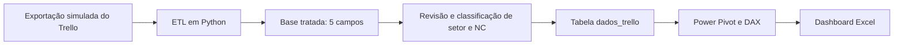

# Quality Analytics | Gestão de Não Conformidades

[English version](README.en.md)

**Excel · Power Pivot · DAX · Python · ETL · Data Quality**

## Contexto e minha contribuição

Desenvolvi do zero uma solução de acompanhamento de não conformidades durante minha atuação como analista de qualidade no setor alimentício. O desafio era transformar registros operacionais não estruturados em informações úteis para a gestão. Minha atuação envolveu extração, tratamento e validação de dados, criação de indicadores, dashboards, análise de desvios e documentação do processo. A automação Python foi desenvolvida com apoio de IA e conferência dos resultados.

A versão de portfólio preserva a estrutura do dashboard original: layout, tabelas dinâmicas, segmentações, gráficos e modelo Power Pivot. Os registros foram substituídos por dados sintéticos; as macros de navegação foram removidas e substituídas por hiperlinks. O script e a documentação foram adaptados para demonstração.

## Arquitetura



## Dados e indicadores

A demonstração usa 529 ocorrências fictícias de 2025, seis lojas fictícias (L01–L06), seis categorias, 14 setores e 23 tipos de NC. Nenhum resultado deve ser interpretado como desempenho real de uma empresa.

- Contagem de ocorrências, evolução temporal e distribuição por categoria.
- Comparação de unidades, produtos e setores; análise de recorrências e concentração.
- Filtros interativos, tabelas dinâmicas, modelo de dados e medidas DAX.

Contagem de ocorrências não equivale a taxa de defeitos: não há denominador de produção. A medida denominada `Qtd Distinta` no original utiliza COUNT(ID), não DISTINCTCOUNT; com IDs únicos, os resultados coincidem.

## Execução

Requisitos: Python 3.10+ e Excel desktop para Windows com Power Pivot para explorar e atualizar o painel.

```bash
python -m pip install -r requirements.txt
python scripts/processar_nc.py data/raw/trello_export_synthetic.csv data/processed/non_conformities_clean.xlsx
python -m unittest discover -s tests -v
```

O script também aceita exportação XLSX. Filtra MÊS ATUAL (lista simulada), separa data, loja e produto, normaliza textos, extrai categorias e sinaliza inconsistências. Datas sem ano usam 2025 na demonstração. O resultado contém cinco campos; setor e NC são classificados em etapa posterior. A base completa de oito campos já acompanha o projeto em `data/processed/dashboard_input.xlsx`.

Para explorar o dashboard, abra `dashboard/quality_dashboard.xlsx`. Para atualizar a base, use as instruções do [guia](docs/user_guide.md). Não regrave o dashboard com bibliotecas genéricas de planilhas, pois podem remover recursos do Power Pivot.

## Organização

| Caminho | Finalidade |
|---|---|
| `dashboard/quality_dashboard.xlsx` | Dashboard original adaptado, sem macros |
| `data/raw/trello_export_synthetic.csv` | Entrada simulada, construída a partir da base fictícia |
| `data/processed/non_conformities_clean.xlsx` | Saída do ETL |
| `data/processed/dashboard_input.xlsx` | Base completa, com classificação demonstrativa |
| `scripts/` | Tratamento de dados |
| `tests/` | Testes unitários |
| `docs/` | Guia e dicionário de dados |

## Privacidade e limitações

A base tabular distribuída é sintética. A validação estrutural do Excel não certifica todo o conteúdo binário do Power Pivot. A versão deve ser validada no Excel desktop e revisada quanto à confidencialidade e à autorização de divulgação antes de tornar o repositório público. Não foram estimados ganhos financeiros ou reduções de tempo sem medições documentadas.

## Autor

Rafael Gaygher — [LinkedIn](https://www.linkedin.com/in/rafael-gaygher/) · [GitHub](https://github.com/devGaygher)
